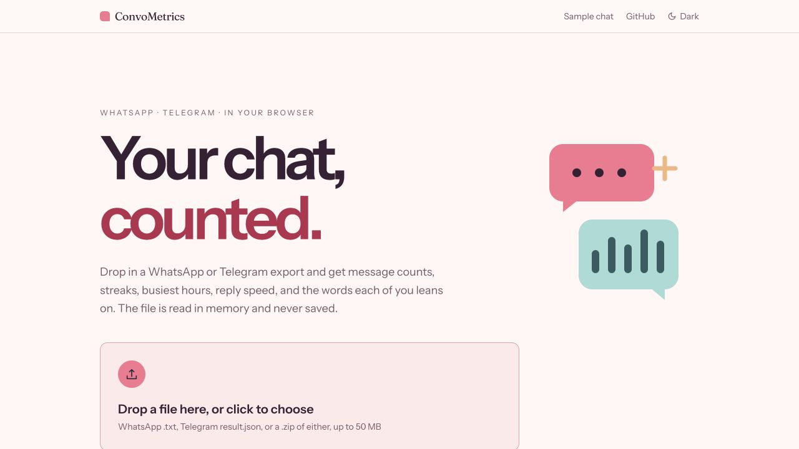
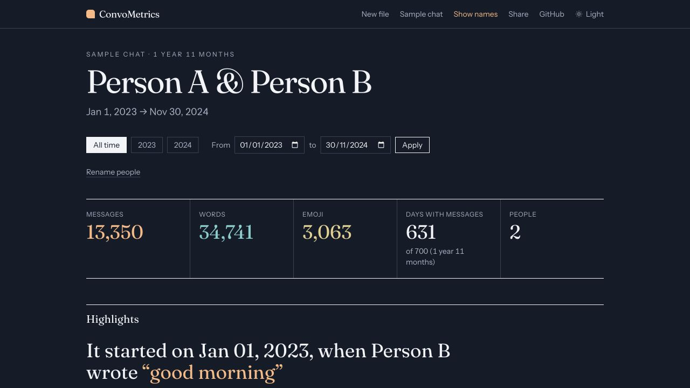

# ConvoMetrics

**ConvoMetrics** turns a WhatsApp or Telegram export into message counts, streaks, activity charts, word and emoji stats.

Built with a **FastAPI (Python)** backend and a **React + Tailwind CSS + Recharts** frontend, it analyzes your conversation history strictly **in-memory** with **zero persistent storage**.

[](docs/media/convometrics-launch.mp4)

*A 24-second launch tour, recorded before the current theme refresh. Click the image to open or download the MP4.*

## A look inside

The screenshots below show the current light and dark themes using the built-in fictional chat (Sam and Alex). The launch video shows an earlier design. No real conversation is shown.


| Upload an export | Search a word |
| --- | --- |
|  |  |
| **Messages over time** | **Dark mode** |
|  |  |

---

## Privacy & Architecture Guarantee

- **100% In-Memory Processing:** Upload bodies are bounded while streaming, and chat files are parsed from memory buffers.
- **No Saved Chat Files:** The application uses no database or object store, and does not write uploaded chat exports to disk.
- **No Retained Chat Sessions:** The server does not cache raw text or DataFrames between requests. Python reclaims request data after it becomes unreachable; immediate memory erasure is not guaranteed. The browser retains the selected file until you reset the app or close the page.

---

## Key Features

**Input**
- WhatsApp `.txt`, Telegram `result.json`, or a `.zip` of either (unzipped in memory, no need to extract first).
- Upload progress, and quick checks on file type and size (50 MB limit) before anything is sent.
- A date filter: all time, one calendar year, or any custom range, re-analysed from the same file.
- A built-in sample chat to try the app without an export.

**What it shows**
- **Highlights:** longest daily streak, first message, length of the chat in printed pages, and superlatives (Night Owl, Early Bird, Emoji Enthusiast, Novelist, Icebreaker, Inquisitor).
- **People:** share of messages (a stacked bar and a share-over-time chart), words, average message length, emoji.
- **Activity:** messages per day, weekday, hour and month; time-of-day buckets; busiest days; message milestones (the 100th, 1,000th, 10,000th message).
- **Conversations:** reply speed per person, how many conversations there were and how long, longest silence, longest run of messages with no reply.
- **Style:** questions, exclamations and late-night messages per person.
- **Words and emoji:** most-used words (English and Hinglish filler removed) and emoji, per person or overall.
- **Word search:** who says a word, and when. The search runs in your browser against an index returned with the first analysis, so nothing is re-uploaded.
- **Links and media:** photos, videos and stickers, links by site and domain, deleted messages.

**Sharing and privacy**
- **Hide names** swaps every name for Person A, Person B, and so on, for a cleaner view when sharing. Names mentioned in free text can still identify people.
- **Rename people** (useful when WhatsApp shows phone numbers).
- **Share cards:** save a 1080×1350 PNG, copy the image or copy a text summary. Choose ink, paper or accent colours; cards follow hidden and renamed people.
- **Export** all stats as JSON, a people table as CSV, or messages per day as CSV. Exports follow what is on screen.

**Interface**
- **Light mode:** blush surfaces, plum text and cherry accents.
- **Dark mode:** midnight-blue surfaces, apricot accents and aqua chart colours.
- Follows your system theme until you choose; your choice is saved in the browser.
- Responsive layouts and motion that respects reduced-motion preferences.
- Group chats: the top five people get their own colour and the rest are grouped as Others.
- Charts come with a text description and data table for screen readers.

---

## Local Development & Running

### Option 1: Run the Complete App (All-in-One)

1. **Install backend dependencies:**
   ```bash
   python3 -m venv .venv
   source .venv/bin/activate
   pip install -r backend/requirements.txt
   ```

2. **Build the React frontend:**
   ```bash
   cd frontend
   npm install
   npm run build
   cd ..
   ```

3. **Start the server:**
   ```bash
   uvicorn backend.main:app --port 8000
   ```
   Open `http://localhost:8000` in your browser. FastAPI automatically serves the built React frontend and API endpoints!

---

### Option 2: Separate Dev Servers (Live Hot Reloading)

1. **Start FastAPI backend:**
   ```bash
   uvicorn backend.main:app --reload --port 8000
   ```

2. **Start Vite React frontend:**
   ```bash
   cd frontend
   npm run dev
   ```
   Open `http://localhost:5173`. Vite proxies `/api` requests to `http://localhost:8000`.

---

## Deployment

The hosted app is connected to [this repository](https://github.com/MeetThakur/ConvoMetrics) on `main`.

| Component | Host | Configuration |
| --- | --- | --- |
| React frontend | [Vercel](https://convometrics-kappa.vercel.app) | Project root `frontend/`; build `npm run build`; output `dist/` |
| FastAPI backend | [Render](https://convometrics-api.onrender.com/api/health) | Docker build with `backend/Dockerfile`, context at the repository root; health check `/api/health` |

Pushes to `main` automatically redeploy both services. The rewrite in [`frontend/vercel.json`](frontend/vercel.json) forwards `/api/*` to Render. Change its destination when deploying your own backend.

The free Render backend sleeps after inactivity; the first analysis may take longer while it starts.

For a single-container deployment, the root Dockerfile includes both the frontend and backend:

```bash
docker build -t convometrics .
docker run -p 8000:8000 convometrics
```

---

## How to Export Your Chats

### Telegram (Desktop)
1. Open the Telegram Desktop app.
2. Open the desired chat.
3. Click the three dots (top-right corner) and select **Export chat history**.
4. Uncheck media files to keep export file lightweight.
5. Under "Format", select **Machine-readable JSON** (`result.json`).
6. Upload the file to ConvoMetrics.

### WhatsApp (Mobile)
1. Open WhatsApp on your phone and open the chat you wish to analyze.
2. Tap the contact or group name at the top.
3. Scroll down and tap **Export Chat**.
4. Choose **Without Media** (creates a `.txt` file).
5. Transfer the `.txt` (or the `.zip` WhatsApp may give you) to your computer and upload it to ConvoMetrics.

---

## Tech Stack
- **Backend:** FastAPI, Pandas, NLTK, Emoji, Uvicorn
- **Frontend:** React 18, Vite, Tailwind CSS, Recharts
- **Deployment:** Vercel frontend + Render Docker backend; optional all-in-one Docker image

---

## Credits (launch video)

- Music: "Happy Beats / Business Moves, Vol. 12" by ende.app.
- Interface sounds: Kenney (CC0).
- Type: Fraunces and Instrument Sans (SIL Open Font License).
- Made with HyperFrames and GSAP.

---

<p align="center">Made by Meet. 100% in-memory and privacy-first.</p>
