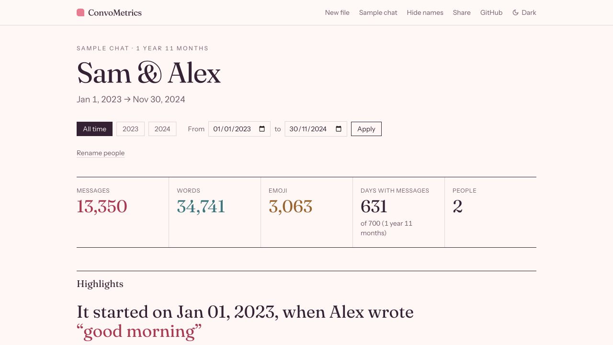
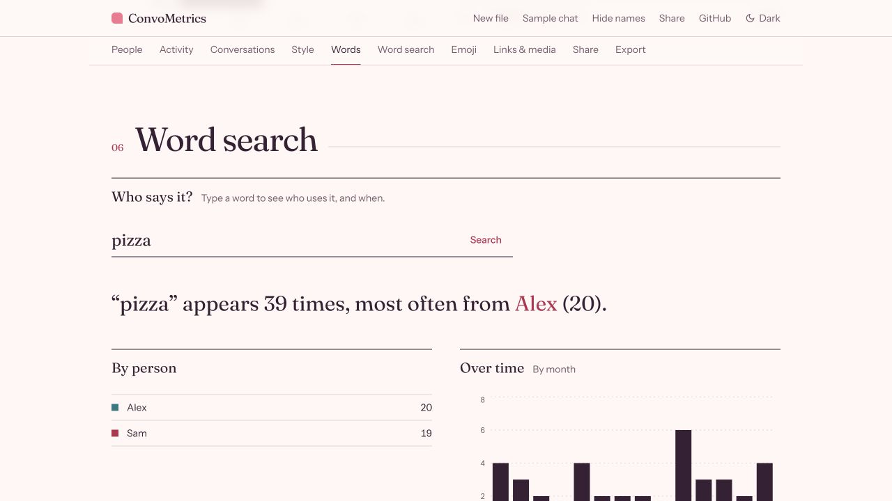
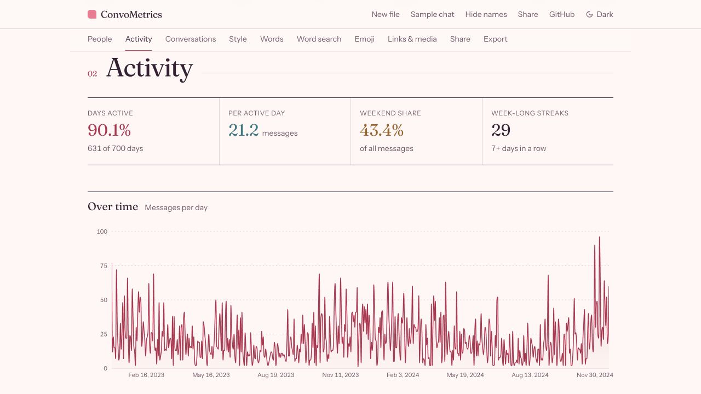
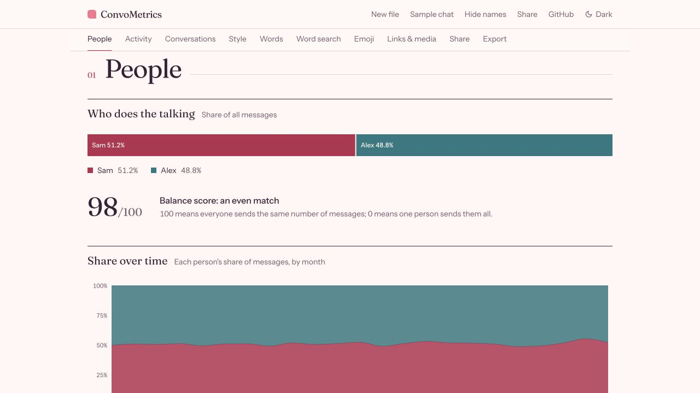
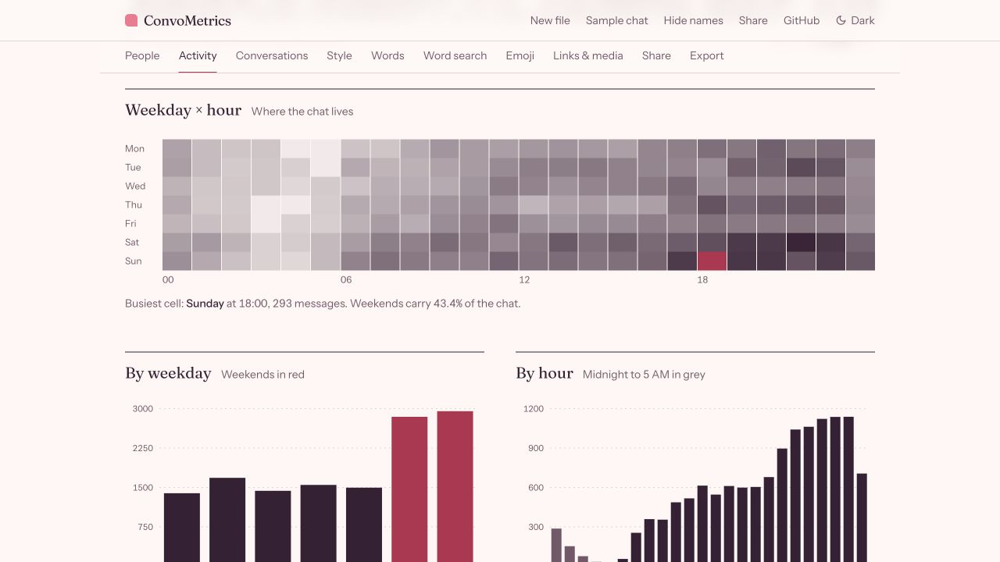
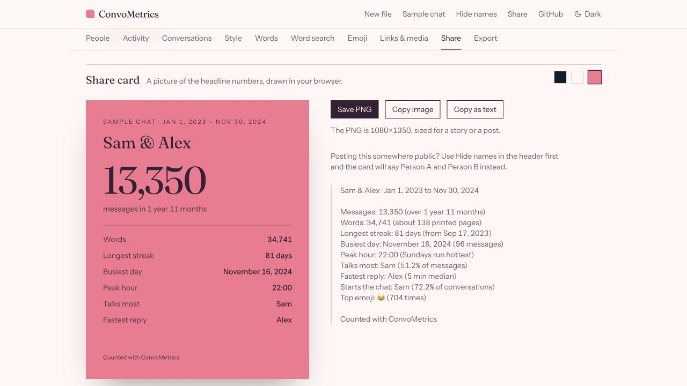

# ConvoMetrics

**ConvoMetrics** turns a WhatsApp or Telegram export into message counts, streaks, activity charts, word and emoji stats.

ConvoMetrics runs Python analytics in a browser Web Worker using Pyodide. The app is a static site, and chat files and results stay on your device.

[](docs/media/convometrics-launch.mp4)

*A 24-second launch tour, recorded before the current theme refresh. Click the image to open or download the MP4.*

## A look inside

The screenshots below show the current light theme using the built-in fictional chat (Sam and Alex). The launch video shows an earlier design. No real conversation is shown.



| Upload an export | Search a word |
| --- | --- |
|  |  |
| **Messages over time** | **Who does the talking** |
|  |  |
| **Weekly activity patterns** | **Made to share** |
|  |  |

---

## Privacy & Architecture Guarantee

- **On-device analysis.** The browser reads and decompresses your export, calculates analytics, and builds the word-search index locally.
- **In-memory sessions.** Starting a new file or closing the page releases the selected file, calculated results, and analysis worker. Downloads and clipboard actions happen when you choose them.
- **Static assets.** The first analysis loads the Python runtime and packages from the same origin as the app. Once the worker is loaded, analysis and date filtering can run offline in that session.

---

## Key Features

**Input**
- WhatsApp `.txt`, Telegram `result.json`, or a `.zip` of either (unzipped in memory, no need to extract first).
- File type and size checks, with a 50 MB limit for the file and the chat export inside a ZIP.
- A date filter: all time, one calendar year, or any custom range, re-analysed from the same file.
- A built-in sample chat to try the app without an export.

**What it shows**
- **Highlights:** longest daily streak, first message, length of the chat in printed pages, and superlatives (Night Owl, Early Bird, Emoji Enthusiast, Novelist, Icebreaker, Inquisitor).
- **People:** share of messages (a stacked bar and a share-over-time chart), words, average message length, emoji.
- **Activity:** messages per day, weekday, hour and month; time-of-day buckets; busiest days; message milestones (the 100th, 1,000th, 10,000th message).
- **Conversations:** reply speed per person, how many conversations there were and how long, longest silence, longest run of messages with no reply.
- **Style:** questions, exclamations and late-night messages per person.
- **Words and emoji:** most-used words (English and Hinglish filler removed) and emoji, per person or overall.
- **Word search:** who says a word, and when. The browser searches the index built during analysis.
- **Links and media:** photos, videos and stickers, links by site and domain, deleted messages.

**Sharing and privacy**
- **Hide names** swaps every name for Person A, Person B, and so on, for a cleaner view when sharing. Names mentioned in free text can still identify people.
- **Rename people** (useful when WhatsApp shows phone numbers).
- **Share cards:** save a 1080×1350 PNG, copy the image or copy a text summary. Choose ink, paper or accent colours; cards follow hidden and renamed people.
- **Export** all stats as JSON, a people table as CSV, or messages per day as CSV. Exports follow what is on screen.

**Interface**
- **Light mode:** blush surfaces, plum text and cherry accents.
- **Dark mode:** midnight-blue surfaces, apricot accents and aqua chart colours.
- Follows your system theme until you choose; your choice is saved in the browser.
- Responsive layouts and motion that respects reduced-motion preferences.
- Group chats: the top five people get their own colour and the rest are grouped as Others.
- Charts come with a text description and data table for screen readers.

---

## Local development

Use Node.js 22 or newer.

```bash
cd frontend
npm ci
npm run dev
```

Open `http://localhost:5173`. The dev and build scripts prepare pinned WebAssembly assets and check package checksums.

Run the browser privacy test with `npx playwright install chromium` followed by `npm run test:browser`.

## Deployment

Build with `npm run build` from `frontend/` and serve the entire `dist/` directory on a static host. The [Vercel project](https://convometricsapp.vercel.app) uses `frontend/` as its root.

The Docker image serves the same static site.

```bash
docker build -t convometrics .
docker run --rm -p 8000:80 convometrics
```

---

## How to Export Your Chats

### Telegram (Desktop)
1. Open the Telegram Desktop app.
2. Open the desired chat.
3. Click the three dots (top-right corner) and select **Export chat history**.
4. Uncheck media files to keep export file lightweight.
5. Under "Format", select **Machine-readable JSON** (`result.json`).
6. Open the file in ConvoMetrics.

### WhatsApp (Mobile)
1. Open WhatsApp on your phone and open the chat you wish to analyze.
2. Tap the contact or group name at the top.
3. Scroll down and tap **Export Chat**.
4. Choose **Without Media** (creates a `.txt` file).
5. Open the `.txt` or `.zip` in ConvoMetrics on your device.

---

## Tech Stack
- **Browser analysis:** Pyodide, pandas, Emoji, and the English stopword list from the NLTK stopwords corpus
- **Frontend:** React 18, Vite, Tailwind CSS, Recharts
- **Deployment:** Static hosting or Nginx in Docker

---

## Credits (launch video)

- Music: "Happy Beats / Business Moves, Vol. 12" by ende.app.
- Interface sounds: Kenney (CC0).
- Type: Fraunces and Instrument Sans (SIL Open Font License).
- Made with HyperFrames and GSAP.

---

<p align="center">Made by Meet. 100% in-memory and privacy-first.</p>
